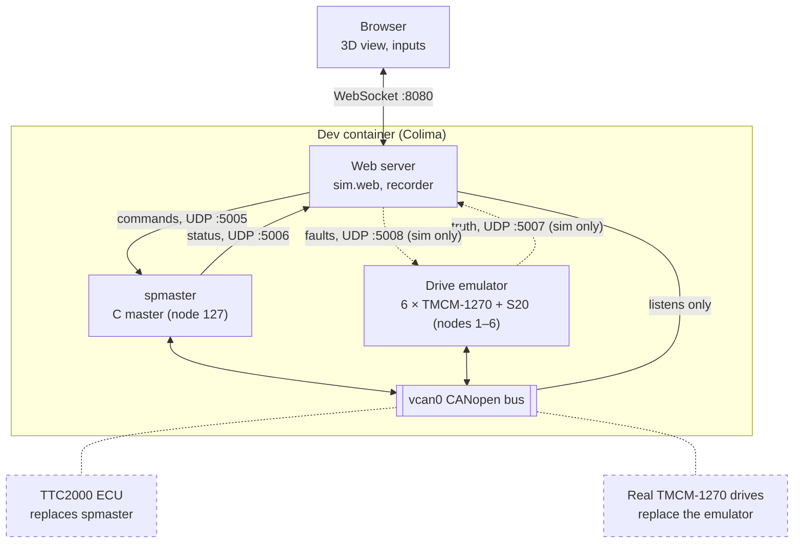
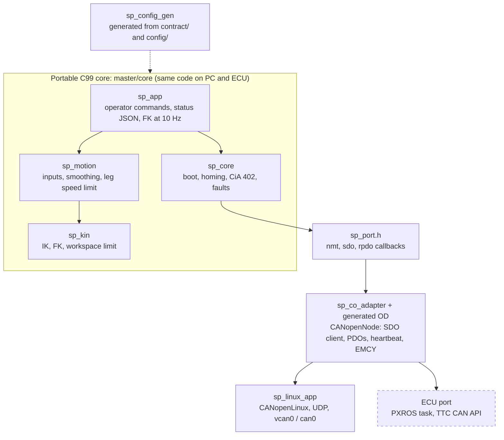

# Architecture

Two views of the system: how the processes connect, and how the C master is layered. Dashed parts come later.
The decisions behind this are in [plan.md](plan.md#architecture-what-is-shared-and-what-is-per-platform).

## System: `make sim` on the Mac

- Everything on the CAN bus behaves like a real CANopen node. The web server only listens to it.
- The master's command and status channel is UDP on the PC. On the ECU it will be local I/O (joystick, IMU) and
  whatever debug link the ECU offers; the JSON commands are listed in [sp_app.h](../master/core/sp_app.h).
- The truth and fault channels exist only in simulation. Truth is the real rod position, which no drive can
  report, so the 3D view can show lost steps.
- Swapping in hardware:
  - Real drives: `SIM_NO_DRIVES=1` stops the emulator.
  - ECU as the master: `SIM_MASTER=none` stops `spmaster`.
  - Both use `CAN_IFACE=can0` for the PCAN adapter.

## C master layers

- `sp_core` reaches CANopen only through the callbacks in `sp_port.h`, so the unit tests can replace the bus with
  a fake one ([fake_bus.c](../master/tests/fake_bus.c)).
- `make gen` writes the config header and the master's object dictionary from the YAML. The ECU build needs no
  Python.
- The core must pass `make -C master portable-check`: strict C99, no implicit `double` (the TC3xx FPU is single
  precision).
- Only the bottom row depends on the platform. What the ECU port needs is in [agents/ecu-port.md](agents/ecu-port.md).
